# 数据安全治理第二次作业 检测指标计算与投毒攻击实验

检测指标计算与数据投毒攻击实验

姓名：____________    学号：____________    实验日期：2026年10月26日

## 习题一 检测指标计算

在内部威胁检测任务中，异常行为为正样例，正常行为为负样例，某算法的检测结果如下图所示，分别计算该检测算法的Accuracy、Precision、Recall、F1、FPR、TPR。

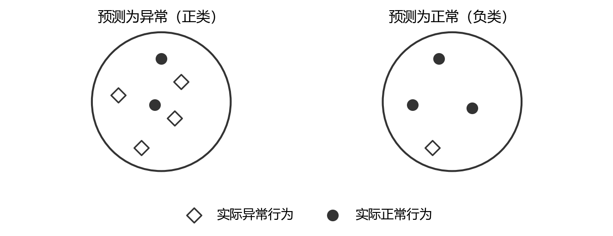

预测异常组中有4个实际异常、2个实际正常；预测正常组中有1个实际异常、3个实际正常。因此TP=4、FP=2、FN=1、TN=3，总样本数为10。

| 实际类别 | 预测异常（正类） | 预测正常（负类） | 合计 |
| --- | --- | --- | --- |
| 实际异常（正类） | TP = 4 | FN = 1 | 5 |
| 实际正常（负类） | FP = 2 | TN = 3 | 5 |
| 合计 | 6 | 4 | 10 |

| 指标 | 计算公式与数值代入 | 结果 |
| --- | --- | --- |
| Accuracy 准确率 | (TP+TN)/(TP+FP+FN+TN) = (4+3)/10 | 70.00% |
| Precision 精确率 | TP/(TP+FP) = 4/(4+2) = 2/3 | 66.67% |
| Recall 召回率 | TP/(TP+FN) = 4/(4+1) = 4/5 | 80.00% |
| F1 分数 | 2TP/(2TP+FP+FN) = 8/(8+2+1) = 8/11 | 72.73% |
| FPR 假正例率 | FP/(FP+TN) = 2/(2+3) = 2/5 | 40.00% |
| TPR 真正例率 | TP/(TP+FN) = 4/(4+1) = 4/5 | 80.00% |

Recall与TPR采用同一分母，即全部实际异常样本；FPR的分母是全部实际正常样本。F1也可写成2×Precision×Recall/(Precision+Recall)，与上表结果一致。

## 习题二 任意投毒与目标投毒实验

## 一 实验目的与攻击界定

本实验通过污染分类模型的训练数据，分别观察整体性能退化和指定类别误判两种后果。实验使用本地真实MNIST手写数字数据，将训练样本固定为10000个，保留独立验证集和官方测试集，完成65次训练。所有实验仅修改训练标签，图像特征与测试集真实标签保持不变。

结果表明，干净MLP的平均测试准确率为95.63%。随机修改60%的训练标签后，准确率降至78.66%；将数字3类内70%的标签定向改为8时，仅修改715个标签，3→8目标误判率达到79.58%。

| 实验问题 | 实现与证据 |
| --- | --- |
| 任意投毒如何设计 | 随机选取训练样本并改为其他类别，以准确率下降和宏平均F1衡量整体破坏。 |
| 目标投毒如何设计 | 仅对源类别3改标为8，测量目标误判率、源类召回率及其他类别准确率。 |
| 哪些因素影响效果 | 实测投毒预算、攻击方式、随机训练过程、类别组合及模型类型。 |
| 如何保证可核查 | 保存65次配置、完整预测、投毒索引、数据哈希、原始日志及11幅图。 |

### 1.1 任意投毒与目标投毒的界定

任意投毒以降低模型整体预测准确率为目标，不要求产生某个指定方向的错误；本实验从全部训练样本中随机改标。目标投毒以使指定样本或类别产生特定错误为目标；本实验仅将源类数字3的部分训练标签改为8，再检查真实数字3被判为8的比例。

## 二 环境 数据与预处理

| 项目 | 本次实际配置 |
| --- | --- |
| 操作系统与计算设备 | Windows 11；CPU执行，无GPU依赖 |
| 解释器与库 | Python 3.12.7；NumPy 1.26.4；scikit-learn 1.5.1 |
| 其他依赖 | SciPy 1.13.1；Matplotlib 3.9.2；threadpoolctl 3.5.0 |
| 数据来源 | 课程model_security_project/data/MNIST/raw中的真实MNIST IDX文件 |
| 抽样与划分 | 官方60000训练样本中分层抽取10000训练、2000验证；官方10000测试样本完整保留 |
| 固定随机协议 | 划分种子20261025；投毒与模型种子17、29、43、71、101 |
| 主模型 | MLP多层感知机，196→96→10；ReLU隐层与softmax分类输出 |
| 训练设置 | Adam；学习率0.001；批量128；L2系数0.0001；固定60轮 |
| 模型对照 | 多项逻辑回归；C=1；L-BFGS；最多1500次迭代且检查未到上限 |

### 2.1 数据有效性检查

程序直接解析IDX二进制头，检查类型、维数、图像尺寸、样本数量和负载长度。若原始文件损坏或缺失，程序终止，不生成随机图像作为替代。四个原始文件的SHA256写入metadata.json，分析阶段再次计算并比对，避免把来源不明的数据当成真实MNIST。

### 2.2 固定预处理与类别规模

每张28×28灰度图使用互不重叠的2×2均值池化得到14×14，再除以255映射至[0,1]，展开为196维特征。该变换没有需要估计的统计参数，因此不会从测试集学习均值、方差或降维方向。

训练集数字3有1022个、数字8有975个，官方测试集数字3有1010个。0→1补充实验中，数字0训练样本为987个，测试样本为980个。验证集来自官方训练集的剩余部分，与本次训练索引完全不相交。

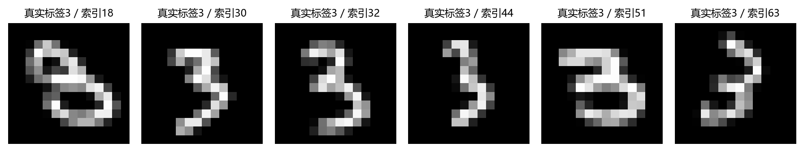

## 三 威胁模型与评估口径

### 3.1 攻击能力与控制变量

攻击者被模拟为能够污染部分训练标注的数据提供方。主实验允许修改标签，不修改原始文件、测试数据或模型程序。每种预算均从原始干净数组复制，重新生成污染数据、重新初始化模型，不继承前一次攻击的参数或标签。

| 控制项 | 具体处理 |
| --- | --- |
| 训练和评估分离 | 投毒索引只在10000个训练样本中选择；测试输入和真值保留原样。 |
| 配对随机种子 | 同一种子下模型初始化、训练次序及投毒候选顺序受同一确定性协议控制。 |
| 训练预算一致 | 全部MLP固定60轮；验证集仅记录过程，不根据测试ASR选轮数。 |
| 多次重复 | 每种配置重复5次，报告均值与样本标准差，保留单次预测。 |

### 3.2 比例分母与主要指标

设训练样本总数N=10000，源类3样本数Ns=1022。任意投毒数量m=floor(r×N)；目标投毒数量m=floor(q×Ns)。统一的全局预算为m/N，源类内部污染比例为m/Ns。只写“投毒70%”而不说明分母会严重误导比较。

整体准确率 Acc = 正确预测样本数 / 10000。任意投毒损害 ΔAcc = 同模型同种子干净准确率 − 投毒准确率，单位为百分点。任意攻击没有指定错误目标，不把“预测错”与3→8的ASR混为一个指标。

目标攻击成功率 ASR(3→8) = 真实为3且预测为8的样本数 / 1010；源类召回率 R3 = 真实为3且预测为3的样本数 / 1010；非源类准确率 Acc¬3 以其余8990个样本为分母。由于还可能错到其他标签，ASR不等于1−R3。

报告同时记录宏平均F1，即先分别计算10类F1后等权平均；这可以补充观察类别性能不均衡。配对ASR增量扣除干净基线中的天然3→8错误；另记录基线正确源类样本被攻击模型判为8的条件比例，用于核对新增错误。

### 3.3 误差线应如何阅读

表中“均值±标准差”和图中误差线都来自5次重复的样本标准差，标准差分母为4；不是95%置信区间。数据划分固定，种子同时改变投毒采样、MLP初始化和训练打乱，因此波动不能完全归因于投毒样本选择，也不代表总体泛化误差。

## 四 实验流程与实现约束

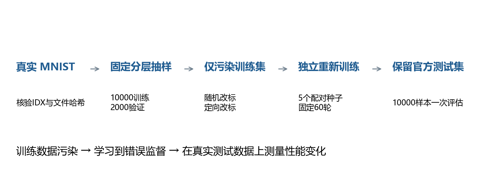

| 配置组 | 预算与次数 |
| --- | --- |
| MLP任意投毒 | 全局0%、7%、10%、20%、40%、60%，各5次，共30次 |
| MLP目标3→8 | 源类10%、30%、50%、70%，各5次，共20次；0%复用5个干净MLP基线 |
| MLP类别对照0→1 | 数字0类内50%，5次 |
| 逻辑回归模型对照 | 3→8源类0%、50%，各5次，共10次 |
| 合计 | 65次真实训练，13组完整统计配置 |

### 4.1 按顺序执行的步骤

第一步，核验原始IDX并保存哈希，进行固定分层抽样。第二步，对每个种子训练干净MLP，保留预测作为配对基线。第三步，按预算污染训练标签并独立训练主实验。第四步，保持数据协议，增加类别和模型对照。第五步，在官方测试集计算最终指标并保存完整预测。第六步，重建统计表、曲线和混淆矩阵，逐项检查计数一致性。

### 4.2 固定训练预算的实现

```python
model = MLPClassifier(hidden_layer_sizes=(96,), activation='relu',
    solver='adam', alpha=1e-4, batch_size=128,
    learning_rate_init=.001, random_state=setting.seed,
    shuffle=True, early_stopping=False)
for epoch in range(1, setting.epochs + 1):
    model.partial_fit(Xp, yp, classes=np.arange(10))
```

partial_fit每次遍历一次当前训练集，持续更新同一模型，避免反复调用fit导致重新训练。训练损失对污染后的监督标签计算，下降只表示更好地拟合当前训练数据，不能自动解释为安全性提高。

## 五 任意投毒的设计与操作

### 5.1 设计思路

任意投毒通过制造方向分散的错误监督，使模型更难恢复“图像—正确类别”的关系。选中的样本可以来自任意训练类别，其错误标签均匀选自原标签之外的9类。图像本身不变，正常测试输入也不变，因此观察到的损害来自训练过程受到污染。

### 5.2 核心改标逻辑

```python
rng = np.random.default_rng(setting.seed)
pool = np.arange(len(y))
order = rng.permutation(pool)
n = int(np.floor(setting.rate * len(pool)))
chosen = order[:n]
yp = y.copy()
alternatives = (y[order] + rng.integers(1, 10, len(order))) % 10
yp[chosen] = alternatives[:n]
assert np.count_nonzero(yp != y) == n
```

偏移量只取1至9再模10，确保每个被选标签都真正改变。若直接从0至9随机赋值，约十分之一的选中样本可能维持原标签，导致“选中比例”高于“实际投毒比例”。同种子共享候选排列与错误标签，随预算扩大形成嵌套集合，减少预算对照中无关的采样差异。

### 5.3 从输入到指标的操作过程

先从10000个训练位置产生随机顺序；例如60%预算取前6000个位置，复制标签后统一执行错误赋值。随后用原始图像与污染标签训练新的MLP，在10000个官方干净测试样本上预测，和同种子干净模型比较准确率、宏平均F1及错误分布。所有预算之间不累计污染。

7%组额外提供低预算观察，与目标70%组的全局7.15%接近，但二者分别改标700个和715个样本。它们不是严格等预算试验，后文只作量级比较，不据此报告精确的攻击效率倍率。

### 5.4 对该方法的预期

较低污染率下，剩余正确标注仍可能主导决策；较高污染率下，模型既要学习图像规律，又要拟合相互冲突的标签，正常泛化性能可能退化。是否单调、何时明显退化、波动多大，都需要依据实际记录判断，不能预先写入结论。

## 六 任意投毒的实测结果

| 全局投毒率 | 改标数 | 准确率 % | 宏平均F1 % | 准确率下降 pp |
| --- | --- | --- | --- | --- |
| 0.00% | 0 | 95.63 ± 0.14 | 95.59 ± 0.14 | 0.00 ± 0.00 |
| 7.00% | 700 | 94.71 ± 0.14 | 94.66 ± 0.15 | 0.92 ± 0.21 |
| 10.00% | 1000 | 94.38 ± 0.17 | 94.33 ± 0.18 | 1.25 ± 0.27 |
| 20.00% | 2000 | 93.29 ± 0.39 | 93.22 ± 0.41 | 2.35 ± 0.49 |
| 40.00% | 4000 | 89.58 ± 0.60 | 89.46 ± 0.60 | 6.05 ± 0.73 |
| 60.00% | 6000 | 78.66 ± 1.07 | 78.34 ± 1.10 | 16.98 ± 1.12 |

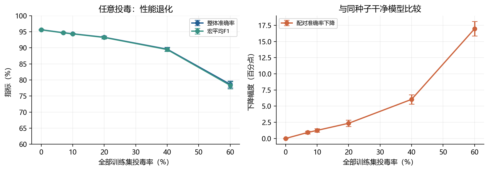

在本次固定训练协议下，平均准确率随污染预算增大而下降。10%污染时为94.38%，40%污染时为89.58%，60%污染时为78.66%，相对干净基线下降16.98个百分点。曲线在高污染段下降更快，说明本模型在剩余正确监督不足时退化明显。

宏平均F1与整体准确率同时下降，表明现象并非仅由某个测试类别数量占比造成。60%组准确率的样本标准差为1.07个百分点，高于干净基线的0.14个百分点，显示大量错误标签还会放大当前训练流程的随机波动。

这里观察到的是若干离散预算上的均值趋势；不能将其提升为任何数据集、任何模型均严格单调的定律。模型仍有明显分类能力，也不意味着6000个错误标注可被数据治理流程接受。

## 七 任意投毒的错误分布

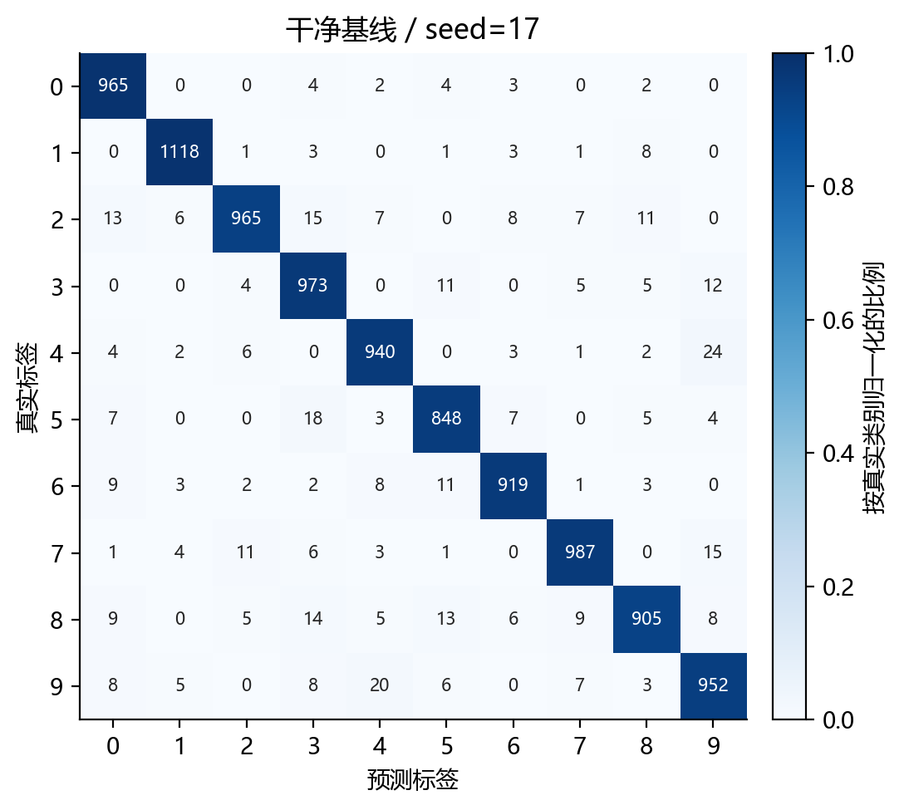

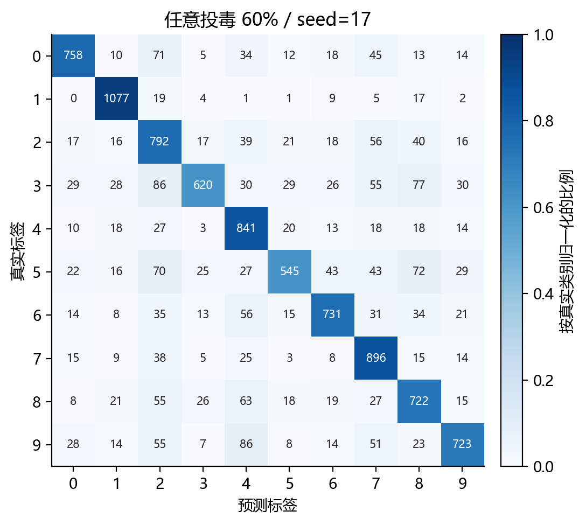

矩阵纵轴为真实标签，横轴为预测标签；颜色按每个真实类别内部归一化，格内数字保留实际样本数量。两幅矩阵来自预先固定的seed=17，避免根据结果挑选最显著的一次。它们不是5次平均矩阵。

| 真实数字 | 干净正确数 | 投毒后正确数 | 该类测试样本数 |
| --- | --- | --- | --- |
| 0 | 965 | 758 | 980 |
| 1 | 1118 | 1077 | 1135 |
| 2 | 965 | 792 | 1032 |
| 3 | 973 | 620 | 1010 |
| 4 | 940 | 841 | 982 |
| 5 | 848 | 545 | 892 |
| 6 | 919 | 731 | 958 |
| 7 | 987 | 896 | 1028 |
| 8 | 905 | 722 | 974 |
| 9 | 952 | 723 | 1009 |

干净模型的质量主要集中在对角线；投毒后多个真实类别向不同错误类别分散，而非统一指向数字8。这与随机错误标签的设计一致。不同类别下降幅度不完全相同，说明即使攻击没有指定对象，数据特征与模型边界也会决定哪些类更脆弱。

对角线变化用于解释错误来源，整体损害仍应回到10000个样本上的准确率以及5次汇总结果。单幅矩阵不能替代重复实验，更不能被当成攻击必然达到的结果。

## 八 目标投毒的设计与操作

### 8.1 设计思路与攻击目标

主目标设为数字3→8。与任意改标不同，所有错误监督都集中在源类3，并统一指向目标类8；训练与测试图像保持不变。这会改变模型对源类区域的决策偏好，使未被修改过的真实测试图像也可能沿指定方向误判。

```python
pool = np.flatnonzero(y == setting.source)
order = np.random.default_rng(setting.seed).permutation(pool)
n = int(np.floor(setting.rate * len(pool)))
chosen = order[:n]
Xp, yp = X.copy(), y.copy()
yp[chosen] = setting.target
assert np.all(y[chosen] == setting.source)
assert np.array_equal(Xp, X)
```

### 8.2 实际操作与预算换算

从1022个数字3训练样本中按同一种子产生顺序，分别取10%、30%、50%、70%的前缀改标为8。例如70%配置向下取整修改715个标签，源类实际污染率为69.96%，对应全局7.15%。其余9285个训练标签保持正确。每种配置独立训练5次。

攻击者对哪个类别改标，评估时就使用该类别的真实测试样本作分母。对3→8实验，源类样本是1010个数字3；不能把全部10000张图像作ASR分母，也不能仅计算攻击模型已经误判的子集。

### 8.3 成功率与正常性能同时检查

```python
source_mask = (ytest == source)
asr = np.mean(pred[source_mask] == target)
source_recall = np.mean(pred[source_mask] == source)
other_accuracy = np.mean(pred[~source_mask] == ytest[~source_mask])
```

定向污染可能主要伤害源类，整体平均分数会稀释其影响。因此同时检查ASR、源类召回率和非源类准确率。干净模型本来就可能把少数3判为8，故paired_runs.csv另保存同模型同种子的ASR增量，避免把天然错误全部归功于攻击。

## 九 目标投毒的实测结果

| 源类设定率 | 改标数 | 全局实际率 | 整体准确率 % | 3→8 ASR % | 数字3召回率 % |
| --- | --- | --- | --- | --- | --- |
| 0.00% | 0 | 0.00% | 95.63 ± 0.14 | 1.21 ± 0.59 | 94.75 ± 1.23 |
| 10.00% | 102 | 1.02% | 95.17 ± 0.17 | 4.34 ± 1.54 | 91.45 ± 1.99 |
| 30.00% | 306 | 3.06% | 93.72 ± 0.66 | 17.84 ± 7.39 | 77.64 ± 7.34 |
| 50.00% | 511 | 5.11% | 90.28 ± 1.53 | 51.88 ± 16.17 | 43.47 ± 15.83 |
| 70.00% | 715 | 7.15% | 87.48 ± 1.13 | 79.58 ± 11.15 | 16.12 ± 11.05 |

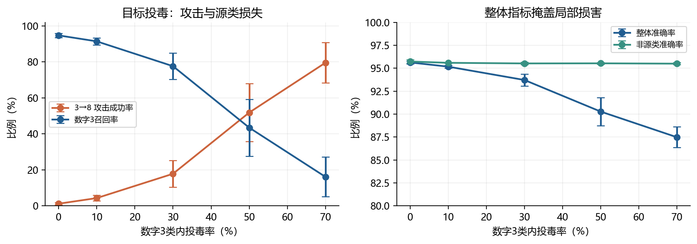

当源类污染率提高到50%时，平均ASR为51.88%，标准差达16.17个百分点；70%时平均ASR为79.58%。源类召回率同时降至16.12%，而非源类准确率仍为95.50%。这说明错误主要集中于数字3，整体准确率87.48%会低估局部破坏程度。

70%配置相对同种子干净模型的ASR平均增加78.38个百分点；仅在基线原本正确的数字3上计算，转为8的条件比例为81.32%。这两项补充统计都支持错误并非仅由原有混淆造成。

相近预算观察中，700个随机错误标签使整体准确率降至94.71%；715个集中错误标签则造成上述严重源类误判。二者预算相差15个样本，且优化目标不同，只能说明污染方向与集中程度值得关注，不能直接认定某类攻击的效率高出多少倍。

## 十 目标错误的逐类与逐样本核查

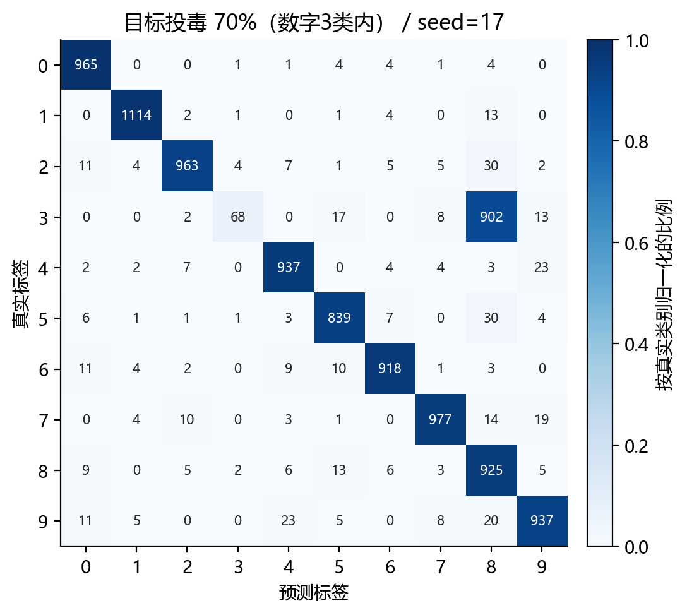

| 预测为 | 0 | 1 | 2 | 3 | 4 | 5 | 6 | 7 | 8 | 9 |
| --- | --- | --- | --- | --- | --- | --- | --- | --- | --- | --- |
| 真实数字3 | 0 | 0 | 2 | 68 | 0 | 17 | 0 | 8 | 902 | 13 |

该次1010个数字3中，902个被判为8，68个仍判为3，ASR=902/1010=89.31%。该数值属于单次seed=17；5次平均为79.58%，不能把二者混写。其他去向仍有少量样本，因此ASR与召回率不是简单互补。

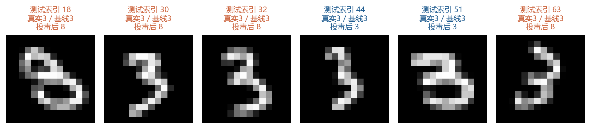

示例保留真实测试索引、干净基线预测和投毒模型预测。它们用于核查“输入没变，训练污染改变了预测”的具体表现；统计结论仍以全部1010个源类样本为准。

## 十一 训练过程与随机性分析

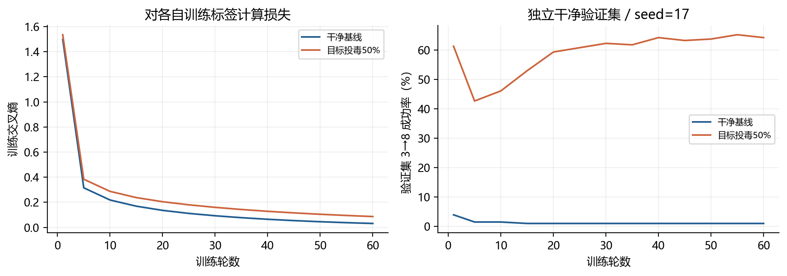

### 11.1 拟合损失下降不等于安全性改善

目标50%配置中，训练损失随轮数总体下降，但独立验证集的3→8错误并未同步减少。原因在于训练目标包含被污染的“正确答案”，优化器降低的是对当前训练标签的损失；它可能越来越好地拟合攻击者注入的错误关系。干净与污染损失对应不同监督内容，不能仅比较谁的损失更低就判断谁更安全。

| 轮数 | 污染训练损失 | 验证集准确率 | 验证集3→8 ASR |
| --- | --- | --- | --- |
| 1 | 1.5358 | 77.00% | 61.27% |
| 10 | 0.2870 | 87.45% | 46.08% |
| 20 | 0.2045 | 87.85% | 59.31% |
| 40 | 0.1280 | 88.35% | 64.22% |
| 60 | 0.0864 | 88.65% | 64.22% |

### 11.2 中间预算更容易出现决策波动

目标50%配置的ASR标准差为16.17个百分点，明显高于干净基线0.59个百分点。源类中正确与错误监督数量接近时，不同投毒位置和随机优化轨迹可能使决策边界偏向不同方向。本结果与这种解释相符，但没有将投毒位置和初始化分别固定，不能断言其中某一个因素独自造成全部波动。

实验固定60轮，图中只展示过程，未根据较高ASR提前终止，也未选择“攻击最成功”的种子作为汇总。这可以避免人为高估攻击效果。训练轮数曲线来自验证集与单个种子，属于过程证据，尚不足以得出所有轮数或模型的因果规律。

## 十二 模型与类别组合的因素对照

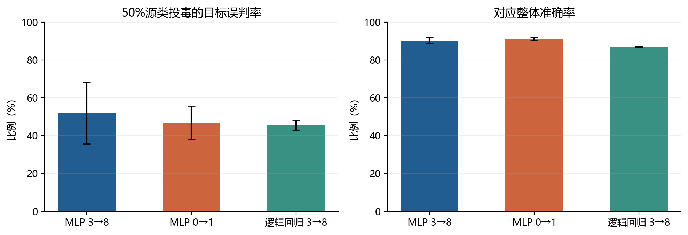

| 配置 | 改标数 | 整体准确率 % | 目标ASR % |
| --- | --- | --- | --- |
| MLP 3→8 | 511 | 90.28 ± 1.53 | 51.88 ± 16.17 |
| MLP 0→1 | 493 | 90.98 ± 0.81 | 46.69 ± 8.90 |
| 逻辑回归 3→8 | 511 | 86.91 ± 0.29 | 45.64 ± 2.69 |

### 12.1 类别组合影响观察到的结果

在相同MLP和50%类内污染率下，3→8的ASR为51.88 ± 16.17% ，0→1为46.69 ± 8.90% 。二者的随机波动较大，不能据此确定哪一组永远更易受攻击。数字0和3的训练基数不同，实际改标493和511个，因此该实验比较的是相同类内比例，不是严格相同样本预算。

类别间形态、样本多样性、天然混淆和源类正确标注规模都可能参与影响。当前只比较两个组合，没有单独测量形态相似度，不能把两组均值差全部归因于“3与8看起来更像”。

### 12.2 模型决定拟合噪声的方式

逻辑回归干净准确率为91.53%，50%目标污染后为86.91%，ASR为45.64%。MLP具有非线性隐层，干净识别能力更高，但目标污染下依然会明显偏移。不能只比较污染后的绝对准确率来判断抗性，应结合各自基线、ASR及波动。

两类模型的容量、优化方法和正则化参数化同时不同，本对照支持“模型选择会改变结果”的局部观察，不是对模型容量或正则化强度的单因素因果证明。正则化强度、数据规模等因素仍需额外网格或消融实验验证。

## 十三 影响因素与数据治理建议

| 因素 | 本次证据与结论边界 |
| --- | --- |
| 污染预算和实际分母 | 主实验实测：任意预算增大时整体损害加重，目标类内预算提高时ASR总体上升；比例必须换算成实际样本数。 |
| 错误监督方向 | 随机改标形成分散错误，3→8改标集中伤害源类；二者追求的攻击目标不同，不能只用一个指标排名。 |
| 随机采样与训练轨迹 | 5次重复揭示目标50%组的大幅波动；本协议未把采样与初始化影响完全拆开。 |
| 模型和类别组合 | 已做局部对照；样本数、容量与优化方式存在共同变化，不宜作普遍强弱排序。 |
| 数据量 类别不均衡 正则化 | 理论上会改变干净监督的约束和噪声拟合，但本次没有单独改变这些因素。 |

### 13.1 以数据完整性为中心的处置

数据接收阶段应记录来源、数据版本、标注者和修改历史，对异常标签迁移比例及集中源类错误设置复核规则。本实验的目标攻击集中把3迁为8，提示审核不能只看总体错误率，也应检查“原标签→新标签”的方向和类别内部占比。

训练阶段保存不可变数据快照、固定划分和输入哈希，建立来源可信的独立验证集。哈希只能证明文件是否变化，不能识别一个从一开始就被错误标注的数据集；异常标签仍需抽检、来源核验或独立复标。

模型验收同时检查整体准确率、每类召回、定向误判矩阵。若发现异常，应定位受影响数据版本，隔离来源并进行独立复标；从可信数据重训后，重新检查正常性能和目标误判。

### 13.2 建议与已验证防御的区别

以上是由实验现象推导的数据治理建议。本次没有实现标签清洗、异常检测、鲁棒训练或防御重训实验，因此不报告防御成功率，也不保证某项建议可独立消除投毒。对于真实场景，还应覆盖更多数据规模、多个划分与业务代价。

## 十四 复现步骤与结果核验

### 14.1 在实验目录运行

正式实验源代码位于poisoning_lab，依赖版本固定在requirements.txt。进入该目录后执行以下命令；默认读取同级课程项目中已存在的MNIST原始文件。整个实验不需要PyTorch，也不需要联网拉取数据。

```powershell
python -m pip install -r requirements.txt
python experiment.py
python analyze.py
```

如数据位于其他目录，可在experiment.py后加--data-dir指定存放四个未压缩IDX文件的路径。程序依靠数据与源码指纹决定是否复用逐次记录；若要重新计算所有模型，先把旧results目录改名备份再运行。--smoke只用于短流程检查，其输出放在独立目录，不参与正式统计。

### 14.2 文件与检查点

| 文件或目录 | 可核查内容 |
| --- | --- |
| experiment.py / analyze.py | 完整攻击构造、训练、评估与统计过程 |
| results/metadata.json | 实际版本、时间、65次训练、划分和原始数据SHA256 |
| results/execution.log | 每次配置、改标数、准确率、ASR、耗时 |
| results/runs/*.json 与 *.npz | 逐次训练历史、完整测试预测、矩阵及污染索引 |
| results/runs.csv / paired_runs.csv | 原始指标及同模型同种子基线差值 |
| results/summary.csv / summary.json | 每配置5次均值和样本标准差 |
| results/audit.json / figures | 完整性审计和11幅原始图表 |

审计已核对全部65次结果：原数据哈希未变；训练与验证索引不相交；实际改标数量与声明一致；目标样本确实只来自源类；保存的测试真值与原始官方真值一致；每次混淆矩阵总数为10000；ASR计数和分母吻合；每组均有5个种子。

### 14.3 实际运行日志节选

```text
[1/65] mlp_indiscriminate_3to8_0_s17_e60 n=0 acc=95.7200% ASR=0.4950% time=3.0s
[10/65] mlp_targeted_3to8_0.7_s17_e60 n=715 acc=86.4300% ASR=89.3069% time=3.0s
COMPLETE 65 fitted models, elapsed=172.9s
```

节选保留原始数值并为排版换行，完整日志随附。耗时是本机运行记录，不是其他设备的性能保证；汇总结果依赖所列软件版本，跨版本数值可能有小幅变化。

## 十五 实验总结

### 15.1 对题目两项要求的回答

设计思路方面，任意投毒在全训练集制造随机错误标签，追求整体可用性下降；目标投毒只把源类3改标为8，追求指定方向的误判。前者在60%预算下使准确率由95.63%降至78.66%；后者在全局7.15%预算下使目标ASR达到79.58%。两类攻击都只改变训练数据，最终在保留真实标签的独立测试集上确认后果。

影响因素方面，投毒量、类内集中度、错误标签方向、随机采样与优化、模型、类别组合都会影响观察结果。最直接的实测证据来自预算曲线；其他对照须保留样本数量、模型参数共同变化以及随机波动的限制。数据量和正则化等未做单因素实验的内容仅作为待验证因素。

对数据安全治理而言，总体准确率不足以发现所有完整性问题。目标投毒要求关注业务关键类别的定向错误。可追溯数据、独立评估集、逐类指标与可重复的记录共同构成实验和治理的基础。
